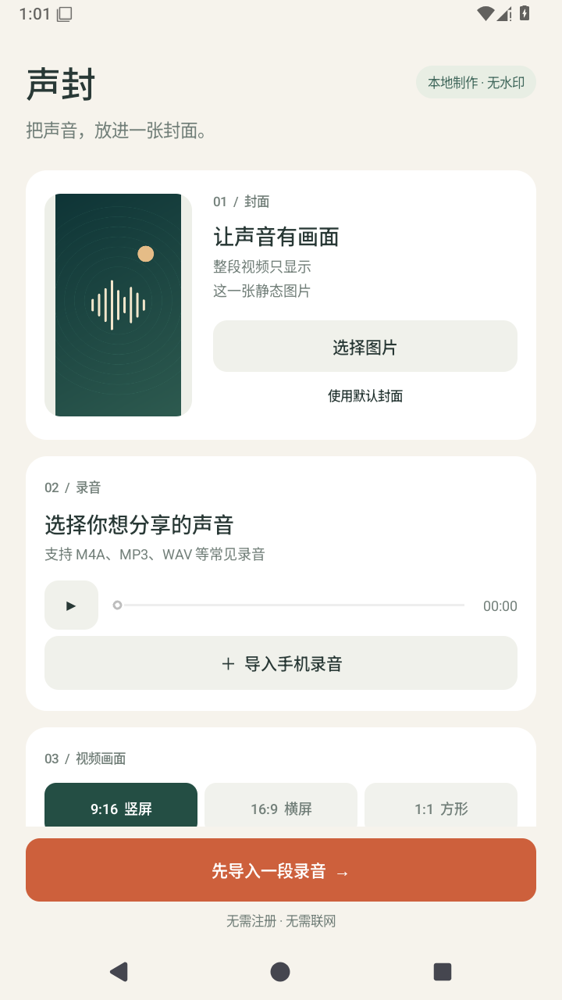
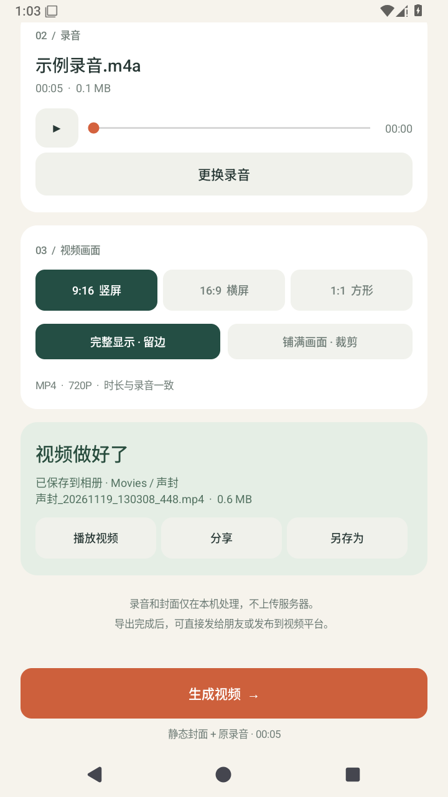

# 声封 · 录音转封面视频

把手机录音和一张图片合成为 MP4。整段视频保持同一张封面，播放你的录音。

**[下载安卓安装包](https://github.com/1sunzichen/voicecover-android/releases/latest/download/VoiceCover-1.0.0.apk)** · [全部版本](https://github.com/1sunzichen/voicecover-android/releases) · [隐私说明](PRIVACY.md)

## 使用

1. 安卓手机下载 `VoiceCover-1.0.0.apk`，允许浏览器或文件管理器安装未知应用，然后安装。
2. 打开声封，导入录音，选择封面，也可保留默认封面。
3. 选择竖屏、横屏或方形，点击生成视频。
4. 导出后直接播放、分享或另存。

支持 Android 8.0 及以上。Android 10 及以上保存到相册 `Movies/声封`；Android 8–9 保存到应用目录，可另存到手机。GitHub Releases 是安装包下载渠道，并非手机应用商店。

## 功能

- M4A、MP3、WAV 等手机支持的录音格式，也支持录音机“分享 → 声封”。
- 自选封面、默认封面，完整显示或居中裁剪。
- 720P 竖屏、横屏、方形，MP4 / H.264 / AAC。
- 试听、进度拖动、后台导出、取消、保存、分享。
- 全程本机处理，无登录、无广告、无水印。

特殊录音格式取决于手机解码器；导出受系统省电策略影响。建议先用一段短录音确认兼容性。视频中的音频可能转码为 AAC。

此仓库用于分发签名安装包和使用说明。安装包可免费下载使用。

## 界面

 

## 验证范围

在 Android 15 / ARM64 模拟器上完成了 5 项仪器测试，覆盖 WAV、M4A、MP3 合成、静态封面、时长、取消重试及媒体库保存。签名发布版完成文件选择、生成、系统分享入口与另存为的实际操作。另验证了 3 分钟录音的后台导出，成片 180.07 秒。尚未覆盖各品牌实体手机。
